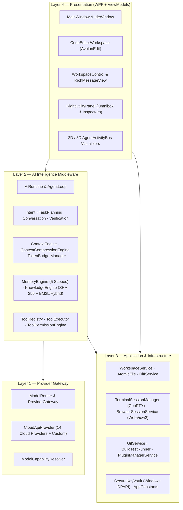
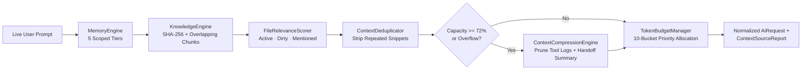

<div align="center">

# LlmodelBox

**AI-Native Software Engineering IDE & Multi-Provider Desktop Workspace**

<p>
  <a href="https://dotnet.microsoft.com/download/dotnet/8.0"></a>
  <a href="#ide-workspace--utility-panel"></a>
  <a href="#token-intelligence"></a>
  <a href="#testing--verification"></a>
</p>

Built in **C# / .NET 8 WPF** for Windows 10/11.  
Unifies **480+ models across 14 cloud providers**, an **AvalonEdit code workspace**, **ConPTY terminal**, **WebView2 browser**, **BPE token budgeting**, **5-scope persistent memory**, **auto-compaction**, and **incremental SHA-256 codebase indexing** inside a strict four-layer architecture.

[Architecture](#target-architecture) &bull; [Core Subsystems](#core-subsystems) &bull; [IDE Workspace](#ide-workspace--utility-panel) &bull; [Commands & Shortcuts](#slash-commands--shortcuts) &bull; [Build & Deployment](#build--deployment) &bull; [Providers & Security](#provider-matrix--security)

</div>

---

## Executive Overview

LlmodelBox replaces fragmented browser chat tabs and disconnected scripts with an engineering-first desktop IDE engineered for deterministic reliability:

- **Unified Provider Gateway:** Normalizes streaming, tool calls, capability metadata, rate-limit retries, and error envelopes across 14 cloud providers and custom OpenAI-compatible endpoints behind `IModelRouter`.
- **Token Intelligence & Real BPE Accounting:** Replaces crude character-length guesses with model-specific `Microsoft.ML.Tokenizers` (`o200k_base`, `cl100k_base`) counters, heuristic fallbacks with explicit confidence tags, 10-bucket budget reservations, and separated input/output cost calculation.
- **5-Scope Memory & Auto-Compact Pipeline:** Maintains distinct lifetimes (`CurrentTurn`, `CurrentConversation`, `CurrentSession`, `CurrentProject`, `UserGlobal`) with approval-gated global promotion, automatic handoff summarization at configurable capacity thresholds, and duplicate-free priority context packing.
- **Incremental Codebase Indexing:** Tracks file changes via SHA-256 content hashes, `.gitignore` / `.llmodelboxignore` exclusions, overlapping line-tracked code chunks, and optional embedding-backed Reciprocal Rank Fusion with deterministic BM25 fallback.
- **Hardened Workspace Operations:** Confines built-in AI file tools (`ReadFileTool`, `ListDirectoryTool`, `WriteFileTool`) to the active repository root with symlink/reparse, alternate-data-stream, and path-traversal guards alongside Windows DPAPI secret storage (`SecureKeyVault`).

---

## Target Architecture

LlmodelBox strictly separates transport, intelligence middleware, OS/workspace infrastructure, and WPF presentation into four decoupled layers (`ArchitectureLayerTests` verified).



---

## Core Subsystems

### Context Intelligence & Auto-Compact Pipeline

Every AI turn executes an ordered, deterministic assembly pass before leaving the machine, protecting reasoning quality against context bloat and middle-turn drift.



| Layer / Component | Responsibility | Implementation |
| :--- | :--- | :--- |
| **Scoped Memory** | `CurrentTurn`, `CurrentConversation`, `CurrentSession`, `CurrentProject`, and `UserGlobal` records with confidence, TTL expiration, and explicit approval gating (`UserGlobal` rejects unapproved auto-promotion). | [`MemoryEngine.cs`](src/Runtime/Memory/MemoryEngine.cs), [`ConversationMemory.cs`](src/Runtime/Memory/ConversationMemory.cs) |
| **Auto-Compaction** | Prunes verbose historical tool payloads first, then condenses older turns into a structured `[Auto-Compacted Conversation Handoff]` summary preserving touched file paths and outcomes. | [`ContextCompressionEngine.cs`](src/Runtime/Context/ContextCompressionEngine.cs) |
| **Priority Allocation** | Reserves non-droppable prompt, system, tool-schema, and attachment tokens before allocating scored files, deduplicated knowledge, recent turns, and output headroom. | [`ContextEngine.cs`](src/Runtime/Context/ContextEngine.cs), [`ContextSourceReport.cs`](src/Runtime/Context/ContextSourceReport.cs) |
| **Incremental Knowledge** | Reuses cached chunks and embeddings whenever SHA-256 content hashes match; parses `.gitignore` / `.llmodelboxignore`; fuses optional dense embeddings with BM25 fallback. | [`KnowledgeEngine.cs`](src/Runtime/Knowledge/KnowledgeEngine.cs), [`KnowledgeIndex.cs`](src/Runtime/Knowledge/KnowledgeIndex.cs) |

### Token Intelligence

`TokenBudgetManager` and `TokenizerRegistry` track ten distinct prompt budget categories with confidence provenance (`ExactBpe` vs. `EstimatedFallback`), token-boundary truncation, and split input/output pricing:

| Bucket | Reservation Priority | Truncation / Overflow Behavior |
| :--- | :--- | :--- |
| **Live User Prompt** | Highest (Protected) | Never evicted behind historical context |
| **System Instructions & Tool Schemas** | Critical Overhead | Reserved upfront against `EffectiveInputBudget` |
| **Attachments & Scoped Memory** | Pinned Context | Deduplicated and injected prior to history |
| **Conversation Handoff Summary** | Pinned Continuity | Retained across compaction boundaries |
| **Open & Scored Workspace Files** | Working Set | Truncated cleanly at BPE token boundaries when supported |
| **Retrieved Code Snippets** | On-Demand Knowledge | Filtered against active editor lines to eliminate duplication |
| **Recent History & Output Reserve** | Rolling / Reserved | Oldest turns compacted first; completion output headroom locked |

---

## IDE Workspace & Utility Panel

- **Code Editor (`CodeEditorWorkspace`):** Powered by `AvalonEdit 6.3.1.120` with syntax highlighting, dynamic dark fold margins, multi-file tabs, unsaved buffers tracking, Find & Replace (`Ctrl+F` / `Ctrl+H`), Go to Line (`Ctrl+G`), atomic disk writes, and inline AI edit diff previews.
- **Collapsible Right Utility Panel (`RightUtilityPanel`):** Smoothly transitions between **Expanded**, **Collapsed Icon Rail**, and **Hidden** modes (`Ctrl+Shift+U`) with persisted widths and theme-aware surfaces (**Midnight**, **Slate**, **Daylight**).
- **Integrated Developer Tools:**
  - **Omnibox (`Ctrl+P`):** Unified search across workspace files, commands, recent items, URLs, and utility views.
  - **Review:** Multi-file diff inspector across AI-generated edits, manual buffer modifications, and Git working-tree changes with inline/split views and hunk/revert actions.
  - **Terminal (`ConPTY`):** Multi-tab persistent shell sessions supporting PowerShell, CMD, and Git Bash with streaming output, environment controls, exit codes, and cancellation.
  - **Browser (`WebView2`):** Tabbed embedded browser with navigation history, downloads, and separated automation permission controls.
  - **Side Question:** Isolated secondary AI thread for parallel exploration without polluting main conversation memory.
  - **Inspectors:** Dedicated views for **Scoped Memory CRUD**, **Context Source Attribution**, **Model Usage Analytics**, **Agent Activity Timeline**, **Code Search**, **Problems**, **Run/Test**, **Git Source Control**, and **Plugins**.

---

## Slash Commands & Shortcuts

| Input / Shortcut | Scope | Action |
| :--- | :--- | :--- |
| `/compact [focus]` | Workspace Chat | Triggers immediate manual compaction with an optional focus directive (`UpdatedConversationSummary`) |
| `/autocompact on \| off \| <40-92>` | Workspace Chat | Toggles background Auto-Compact or sets the trigger percentage threshold |
| `/context` | Workspace Chat | Expands and switches directly to the **Context Inspector** view |
| `Ctrl+P` | IDE Global | Opens and focuses the Right Utility Panel Omnibox |
| `Ctrl+Shift+U` | IDE Global | Toggles Right Utility Panel display mode (Expanded / Icon Rail / Hidden) |
| `Ctrl+S` | Code Editor | Atomically saves the active buffer to disk |
| `Ctrl+F` / `Ctrl+H` / `Ctrl+G` | Code Editor | Opens inline Find, Replace, and Go-to-Line overlays |

---

## Repository Structure

<details>
<summary><strong>Expand Solution Layout (<code>src/</code>, <code>tests/</code>, <code>tools/</code>)</strong></summary>

| Path | Role & Key Types |
| :--- | :--- |
| `src/Presentation/` | `AppServiceHost`, MVVM `ViewModels` |
| `src/Controls/` | `WorkspaceControl`, `NeuralNetVisualizer`, `NeuralNet3DVisualizer` |
| `src/Controls/Editor/` | `CodeEditorWorkspace` (AvalonEdit host, tabs, overlays, inline preview) |
| `src/Controls/UtilityPanel/` | `RightUtilityPanel` (Omnibox, Review, Terminal, Browser, Side Q, Plugins, Inspectors) |
| `src/Controls/RichChat/` | `RichMessageView` (structured cards, timelines, diffs, sanitized Markdown) |
| `src/Providers/` | `ModelRouter`, `CloudApiProvider`, `ProviderGateway`, `ModelCapabilityResolver` |
| `src/Runtime/` | `AiRuntime`, `SessionManager`, `TaskManager` |
| `src/Runtime/Context/` | `ContextEngine`, `ContextCompressionEngine`, `FileRelevanceScorer`, `ContextDeduplicator` |
| `src/Runtime/Memory/` | `MemoryEngine`, `JsonMemoryStore`, `ConversationMemory`, `JsonChatHistoryStore` |
| `src/Runtime/Knowledge/` | `KnowledgeEngine`, `KnowledgeIndex`, `OpenAiCompatibleEmbeddingProvider` |
| `src/Runtime/Tokens/` | `TokenizerRegistry`, `TokenBudgetManager`, token pricing & cost estimation |
| `src/Runtime/Intent/` | `IntentEngine` (deterministic turn classification & gate control) |
| `src/Runtime/Tools/` | `AgentLoop`, `ToolExecutor`, `ToolPermissionEngine`, sandboxed `Builtin/` tools |
| `src/Runtime/Middleware/` | Layer 2 service contracts & coordination wrappers |
| `src/Infrastructure/` | `EditorLanguageService`, ConPTY terminal, WebView2 browser, Git, build/test runner, plugins |
| `src/Services/` | `SecureKeyVault`, `SettingsService`, `CloudApiService`, `TokenUsageService`, `ThemeManager`, `AgentActivityBus` |
| `src/Common/` | `AtomicFile`, `MarkdownRenderer`, `ReasoningFilter`, `WorkspacePaths`, `AppConstants` |
| `tests/LlmodelBox.Tests/` | xUnit test suite (`127` automated tests across architecture, security, runtime, UI, and Part 5) |
| `tools/` | `local-download-server.py` (artifact packaging & SHA-256 verification portal) |

</details>

---

## Build & Deployment

### Prerequisites

- **Operating System:** Windows 10 / Windows 11 (x64)
- **Build & Test:** [.NET 8 SDK](https://dotnet.microsoft.com/download/dotnet/8.0)
- **Runtime (framework-dependent builds):** [.NET 8 Windows Desktop Runtime](https://dotnet.microsoft.com/download/dotnet/8.0)

> [!NOTE]
> `Directory.Build.props` configures `EnableWindowsTargeting`, allowing `win-x64` executables to be cross-compiled on Linux hosts and staged via `tools/local-download-server.py`. Native execution requires Windows.

### Direct CLI Workflow

```powershell
# Restore, compile Release, and execute all 127 xUnit verification tests
dotnet test tests\LlmodelBox.Tests\LlmodelBox.Tests.csproj -c Release

# Build optimized Release binary
dotnet build src\LlmodelBox.csproj -c Release

# Publish framework-dependent distribution to app\improved
dotnet publish src\LlmodelBox.csproj -c Release --no-self-contained -o app\improved

# Publish self-contained single-file win-x64 executable
dotnet publish src\LlmodelBox.csproj -c Release -r win-x64 --self-contained true -p:PublishSingleFile=true -p:IncludeNativeLibrariesForSelfExtract=true -o dist\win-x64-standalone
```

### Automated Packaging Scripts

| Script | Host OS | Function |
| :--- | :--- | :--- |
| `run.bat` | Windows | Launches staged `app\improved\LlmodelBox.exe` or local build output |
| `build.bat` / `build.ps1` | Windows | Interactive or scripted test + `win-x64` publish + optional HTTP artifact portal |
| `build.sh` | Linux | Verifies toolchain, cross-compiles `win-x64`, generates `SHA256SUMS.txt`, serves ZIP portal |
| `Cauto.sh` | Linux VPS | Continuous Git polling daemon with clean-clone rebuilds and hot-swapped staging |

<details>
<summary><strong>Automation CLI Examples</strong></summary>

```powershell
# Windows non-interactive standalone build
.\build.ps1 -Mode windows -Package standalone -NoServe

# Linux cross-compile + local download portal on port 8080
./build.sh --mode linux --package standalone --serve --port 8080

# Unattended continuous builder (30s polling interval)
./Cauto.sh --repo https://github.com/R2Ksanu/LLMBOX-FT.git --branch main --package standalone --port 8080 --interval 30 --yes
```

</details>

---

## Provider Matrix & Security

### Supported Cloud Providers

API keys resolve via the Settings UI (encrypted with Windows DPAPI into `secrets.dpapi` via `SecureKeyVault`) or environment variables:

<details>
<summary><strong>Expand Provider Environment Variables (14 Built-In Providers)</strong></summary>

| Provider | Environment Variable(s) | Provider | Environment Variable(s) |
| :--- | :--- | :--- | :--- |
| **OpenAI** | `OPENAI_API_KEY` | **Cloudflare Workers AI** | `CLOUDFLARE_API_KEY`, `CF_API_TOKEN` |
| **Anthropic** | `ANTHROPIC_API_KEY` | **Mistral** | `MISTRAL_API_KEY` |
| **Google Gemini** | `GEMINI_API_KEY`, `GOOGLE_API_KEY` | **Hugging Face** | `HUGGINGFACE_API_KEY`, `HF_TOKEN` |
| **xAI Grok** | `XAI_API_KEY`, `GROK_API_KEY` | **Cohere** | `COHERE_API_KEY`, `CO_API_KEY` |
| **DeepSeek** | `DEEPSEEK_API_KEY` | **NVIDIA NIM** | `NVIDIA_API_KEY`, `NIM_API_KEY` |
| **Groq** | `GROQ_API_KEY` | **SambaNova** | `SAMBANOVA_API_KEY` |
| **OpenRouter** | `OPENROUTER_API_KEY` | **Zhipu / BigModel** | `ZHIPU_API_KEY`, `BIGMODEL_API_KEY` |

> [!TIP]
> Cloudflare Workers AI endpoints containing `{account_id}` should be added as a Custom OpenAI-Compatible Provider pointing to `https://api.cloudflare.com/client/v4/accounts/<ACCOUNT_ID>/ai/v1/chat/completions`.

</details>

### Security & Data Hygiene

- **Credential Protection (`SecureKeyVault`):** Sensitive provider secrets are encrypted at rest using Windows DPAPI (`CurrentUser` scope) in `%LocalAppData%\LlmodelBox\secrets.dpapi` rather than plain-text config commits.
- **Transactional Continuity Archive (`SqliteContinuityRepository`):** Unified local storage at `%DataDirectory%\llmodelbox_continuity.db` (`WAL` mode, foreign keys, `busy_timeout`, `FTS5` search, `SecretRedactor` scrubbing) across Home Chat, Workspace Chat, handoff checkpoints, and scoped long-term memory.
- **Safe Migration & Rollback Backups:** On first launch, `LegacyDataMigrator` preserves snapshots of `home_conversations.json`, `<hash>.json`, `<hash>.mem.json`, and `global-preferences.mem.json` under `backups/pre-continuity-migration-<timestamp>/`. Damaged databases or malformed JSON files are copied to `backups/corrupt-quarantine/` prior to recovery without discarding recoverable originals.
- **Filesystem Containment (`WorkspacePaths` & `ToolPermissionEngine`):** AI tool execution resolves canonical paths strictly inside the active project root, blocking `..` traversal, NTFS alternate data streams, and reparse points/symlinks.
- **Data Directory Override:** `AppConstants` resolves portable data beside the source tree during development or `%LocalAppData%\LlmodelBox` in standalone installations; set `LLMODELBOX_DATA_DIR` to specify an isolated data directory.

> [!IMPORTANT]
> Never commit `settings.json`, `secrets.dpapi`, `chat/`, `token_usage.json`, `crash.log`, or `backups/` to shared repositories.

---

## Testing & Verification

The automated xUnit suite in `tests/LlmodelBox.Tests/` validates architecture isolation, cryptographic storage, context budgeting, auto-compaction, scoped memory governance, incremental knowledge hashing, editor services, and workspace filesystem safety (`127/127` passing).

<details>
<summary><strong>Test Suite Coverage Breakdown (15 Test Modules)</strong></summary>

| Test Module | Coverage Area |
| :--- | :--- |
| `ArchitectureLayerTests.cs` | Four-layer dependency boundaries across Provider, Middleware, Infrastructure, and UI |
| `Part5IntelligenceTests.cs` | 5-scope `MemoryEngine` CRUD & global gating, Auto-Compact handoff, dedup, SHA-256 incremental & hybrid retrieval |
| `TokenIntelligenceTests.cs` | BPE `o200k_base` / `cl100k_base` counting, 10-bucket allocation, split input/output pricing |
| `ContextEngineTests.cs` | Priority budgeting, turn eviction, oversized open-file truncation |
| `MemoryEngineTests.cs` | Heuristic self-disclosure extraction, goal persistence, preamble formatting |
| `KnowledgeEngineTests.cs` | Tokenization, exclusion rules, ranking, char-budgeted snippet formatting |
| `CodeEditorTests.cs` | AvalonEdit multi-tab workspace state, language detection, badges, inline previews |
| `RightUtilityPanelTests.cs` | Collapsible panel state, Omnibox, terminal/review/plugin contracts |
| `RichChatTests.cs` | Structured message blocks, diff/timeline cards, sanitized Markdown rendering |
| `ToolsBuiltinTests.cs` | Workspace path containment, symlink/ADS rejection, fail-closed approvals |
| `AgentLoopTests.cs` | Bounded multi-step tool loop execution and termination controls |
| `IntentEngineTests.cs` | Deterministic prompt classification and knowledge/tool gating |
| `SecureKeyVaultTests.cs` | DPAPI round-trip encryption and key vault isolation |
| `ReliabilityTests.cs` | `AtomicFile` durability and persistence failure recovery |
| `RuntimeContractTests.cs` | Normalized `AiRequest` / `AiResponse` and provider routing contracts |

</details>
