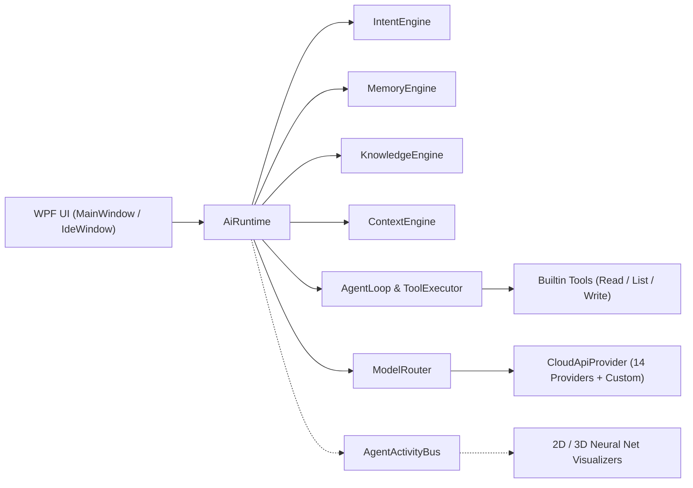

# LlmodelBox

A Windows desktop AI workspace and integrated development environment built with **C# / .NET 8 WPF**. LlmodelBox combines a multi-provider model gateway, a project-aware code editor, a deterministic agent runtime with gated filesystem tools, conversation memory, and real-time 2D/3D neural activity visualization.

---

## Key Capabilities

- **Multi-Provider Gateway & Model Library** — Ships with a catalog of 480+ models across 14 cloud providers (OpenAI, Anthropic, Google Gemini, xAI Grok, DeepSeek, Groq, OpenRouter, Cloudflare Workers AI, Mistral, Hugging Face, Cohere, NVIDIA NIM, SambaNova, and Zhipu) plus custom OpenAI-compatible endpoints.
- **Capability-Aware Routing** — `ModelRouter` selects the best-fit adapter for vision or streaming requests and falls back across capable providers on hard failures without overriding your chosen model.
- **Modular Agent Runtime** — `AiRuntime` coordinates deterministic intent classification, task lifecycle tracking, token-budgeted context assembly, workspace knowledge retrieval, durable memory, and bounded tool-use loops.
- **Gated Workspace Tools** — Built-in `ReadFileTool`, `ListDirectoryTool`, and `WriteFileTool` are sandboxed to the active project root via `WorkspacePaths`, rejecting path traversal, alternate data streams, and reparse points/symlinks, with fail-closed approval via `ToolPermissionEngine`.
- **Integrated IDE & Telemetry** — Includes a project browser/editor (`IdeWindow` / `WorkspaceControl`), Markdown chat renderer (restricted to HTTP/HTTPS links), token usage & latency analytics (`ViewTokenUsage`), 2D/3D `AgentActivityBus` visualizers (`ViewNeuralNet`), system instruction presets, and optional Discord Rich Presence.
- **Atomic Persistence** — Settings, registries, chat history, memory, usage records, and editor saves use stage-and-flush atomic file replacement (`AtomicFile`).

---

## Architecture



---

## Repository Layout

| Path | Purpose |
| :--- | :--- |
| `src/` | .NET 8 WPF application (`LlmodelBox.csproj`) |
| `src/Controls/` | `WorkspaceControl`, `NeuralNetVisualizer`, `NeuralNet3DVisualizer` |
| `src/Providers/` | `ModelRouter`, `CloudApiProvider`, `ModelCapabilityResolver` |
| `src/Runtime/` | `AiRuntime`, `SessionManager`, `TaskManager` |
| `src/Runtime/Context/` | `ContextEngine` (token-budgeted prompt assembly) |
| `src/Runtime/Intent/` | `IntentEngine` (deterministic turn classification) |
| `src/Runtime/Knowledge/` | `KnowledgeEngine` & `KnowledgeIndex` (repo indexing/retrieval) |
| `src/Runtime/Memory/` | `MemoryEngine`, `JsonMemoryStore`, `JsonChatHistoryStore` |
| `src/Runtime/Tools/` | `AgentLoop`, `ToolExecutor`, `ToolPermissionEngine`, `Builtin/` tools |
| `src/Services/` | Persistence, `CloudApiService`, `TokenUsageService`, `ThemeManager`, Discord RPC |
| `src/Common/` | `AtomicFile`, `MarkdownRenderer`, `ReasoningFilter`, `AppConstants` |
| `tools/` | `local-download-server.py` (release packager & local HTTP download portal) |
| `tests/LlmodelBox.Tests/` | xUnit unit and filesystem safety regression suite |

---

## Requirements

- **OS:** Windows 10 / Windows 11
- **Run:** [.NET 8 Windows Desktop Runtime](https://dotnet.microsoft.com/download/dotnet/8.0)
- **Build & Test:** [.NET 8 SDK](https://dotnet.microsoft.com/download/dotnet/8.0)

---

## Getting Started

### Launch Prebuilt Application

Run `run.bat` from the repository root. It prefers the release build under `app\improved\LlmodelBox.exe` and falls back to `LlmodelBox.exe` or local build outputs.

### Dual Builder & Continuous Auto-Deploy (`build.sh`, `build.ps1`, `Cauto.sh`)

`Directory.Build.props` enables `EnableWindowsTargeting`, so you can compile the Windows `win-x64` `.exe` on **either Windows or Linux** and choose between a portable self-contained single-file `.exe` or a lightweight framework-dependent build. When serving is enabled, `tools/local-download-server.py` stages `LlmodelBox.exe`, `LlmodelBox-win-x64.zip`, and `SHA256SUMS.txt` and starts a local HTTP download website (`http://localhost:8080/`).

| Script | Platform | Purpose |
| :--- | :--- | :--- |
| `build.sh` | Linux | Auto-installs missing requirements (`dotnet` 8, `curl`, `python3`), builds `win-x64`, and launches the local download website |
| `build.ps1` / `build.bat` | Windows | Runs tests, builds `win-x64` (standalone or `app\improved`), and optionally hosts the local download website |
| `Cauto.sh` | Linux VPS | Polls GitHub for new commits, clears & freshly clones the repo, rebuilds via `build.sh`, and hot-swaps the live download website |

**Windows (`build.ps1` / `build.bat`):**

```powershell
# Interactive menu (choose profile, standalone vs framework-dependent, and optional local web portal)
.\build.bat

# Non-interactive examples
.\build.ps1 -Mode windows -Package standalone -NoServe
.\build.ps1 -Mode linux -Package standalone -Serve -Port 8080
```

**Linux (`build.sh` — auto-checks & installs `.NET 8 SDK`, `curl`, and `python3` if missing):**

```bash
chmod +x build.sh
./build.sh

# Non-interactive cross-build + local download website
./build.sh --mode linux --package standalone --serve --port 8080

# Check requirements without auto-installing missing tools
./build.sh --no-auto-install --mode linux --package standalone
```

**Linux VPS Continuous Auto-Builder (`Cauto.sh`):**

```bash
chmod +x Cauto.sh
./Cauto.sh

# Unattended VPS mode (polls every 30s, clean-clones on new commits, keeps download site live on :8080)
./Cauto.sh --repo https://github.com/R2Ksanu/LLMBOX-FT.git --branch main --package standalone --port 8080 --interval 30 --yes
```

> **Note:** Building on Linux cross-compiles the Windows WPF executable (`win-x64`), packages it, and serves it over HTTP so you can download `LlmodelBox.exe` from any Windows machine on your network. Running `LlmodelBox.exe` natively requires Windows (or Wine).

### Manual CLI Build & Test

```powershell
# Run the automated test suite
dotnet test tests\LlmodelBox.Tests\LlmodelBox.Tests.csproj

# Publish a framework-dependent release build to app\improved
dotnet publish src\LlmodelBox.csproj -c Release --no-self-contained -o app\improved

# Publish a self-contained single-file win-x64 executable
dotnet publish src\LlmodelBox.csproj -c Release -r win-x64 --self-contained true -p:PublishSingleFile=true -p:IncludeNativeLibrariesForSelfExtract=true -o dist\win-x64-standalone
```

---

## Configuration & Providers

API keys can be configured in the application Settings UI (`settings.json`) or supplied via environment variables:

| Provider | Environment Variable(s) |
| :--- | :--- |
| OpenAI | `OPENAI_API_KEY` |
| Anthropic | `ANTHROPIC_API_KEY` |
| Google Gemini | `GEMINI_API_KEY`, `GOOGLE_API_KEY` |
| xAI Grok | `XAI_API_KEY`, `GROK_API_KEY` |
| DeepSeek | `DEEPSEEK_API_KEY` |
| Groq | `GROQ_API_KEY` |
| OpenRouter | `OPENROUTER_API_KEY` |
| Cloudflare Workers AI | `CLOUDFLARE_API_KEY`, `CF_API_TOKEN` |
| Mistral | `MISTRAL_API_KEY` |
| Hugging Face | `HUGGINGFACE_API_KEY`, `HF_TOKEN` |
| Cohere | `COHERE_API_KEY`, `CO_API_KEY` |
| NVIDIA NIM | `NVIDIA_API_KEY`, `NIM_API_KEY` |
| SambaNova | `SAMBANOVA_API_KEY` |
| Zhipu / BigModel | `ZHIPU_API_KEY`, `BIGMODEL_API_KEY` |

> **Note for Cloudflare Workers AI:** Endpoints containing `{account_id}` must be registered as a Custom Provider with your full account endpoint URL (`https://api.cloudflare.com/client/v4/accounts/<ACCOUNT_ID>/ai/v1/chat/completions`).

---

## Data Directory & Security

- **Storage Resolution:** When running from a source tree, `AppConstants` stores `settings.json`, `models.json`, `projects.json`, `chat/`, and `cache/` under the installation root. Standalone deployments use the executable directory. Set `LLMODELBOX_DATA_DIR` to override with an explicit writable path.
- **Credential Hygiene:** `settings.json` can persist resolved API keys. Never commit `settings.json`, `chat/`, `token_usage.json`, `crash.log`, or `backups/` to public source control.

---

## Testing & Verification

The xUnit suite in `tests/LlmodelBox.Tests/` covers runtime contracts, context budgeting, memory persistence, agent tool loops, builtin path-safety guards, knowledge indexing, intent classification, and atomic file reliability (`48` tests passing). Live provider API calls and interactive UI flows require valid provider credentials.
